---
head:
  - - meta
    - property: og:title
      content: 小七的周刊（第 035 期）：把 AI 的速度变成可回放的证据
  - - meta
    - property: og:description
      content: 从 agent 评测、浏览器自动化到数据血缘，本期讨论如何让快速变化的系统留下可以复核的证据。
  - - meta
    - property: og:image
      content: /images/issues/035/news-cover.jpg
  - - meta
    - property: og:image:alt
      content: 第 035 期封面图：正在运行的计算设备
  - - meta
    - property: og:url
      content: https://blog.leeseven.com/issues/issue-035
---

# 小七的周刊（第 035 期）：把 AI 的速度变成可回放的证据

*这里记录每周值得分享的科技内容，**每周一发布**（北京时间 07:00）。*

## 本期 3 个要点

1. **Agent 的下一关是可回放**：一次成功演示不等于稳定能力，输入、工具调用和失败路径都要能重现。
2. **数据血缘正在进入日常开发**：知道答案从哪里来，才能判断模型输出何时值得采用。
3. **自动化要把异常当一等公民**：重试、人工接管和撤销路径，和 happy path 一样需要测试。

## 封面图

封面图：真实计算设备的局部照片。系统越复杂，越需要把不可见的过程转成可观察信号。

## 本周短谈

### 1. 平台工程的价值是减少认知负担

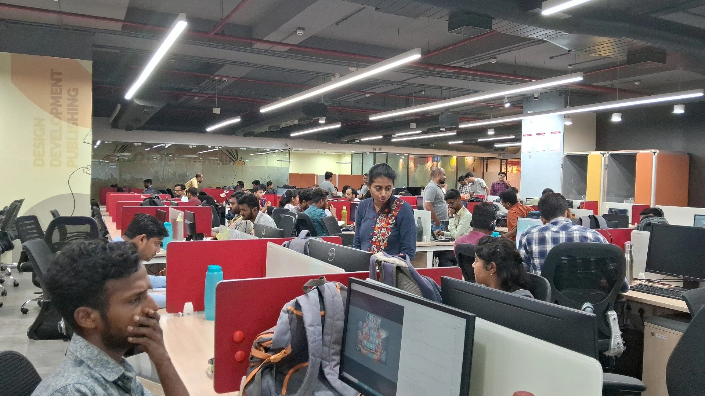

平台工程常被描述成“给开发者一条黄金路径”，但真正的价值不在于再做一个门户，而在于把部署、权限、依赖和回滚的默认选择写进流程。开发者仍然可以偏离路径，只是偏离时要知道代价。对小团队来说，先统一日志、配置和发布检查，比建设完整平台更实际。

### 2. 浏览器自动化最怕成功得太安静

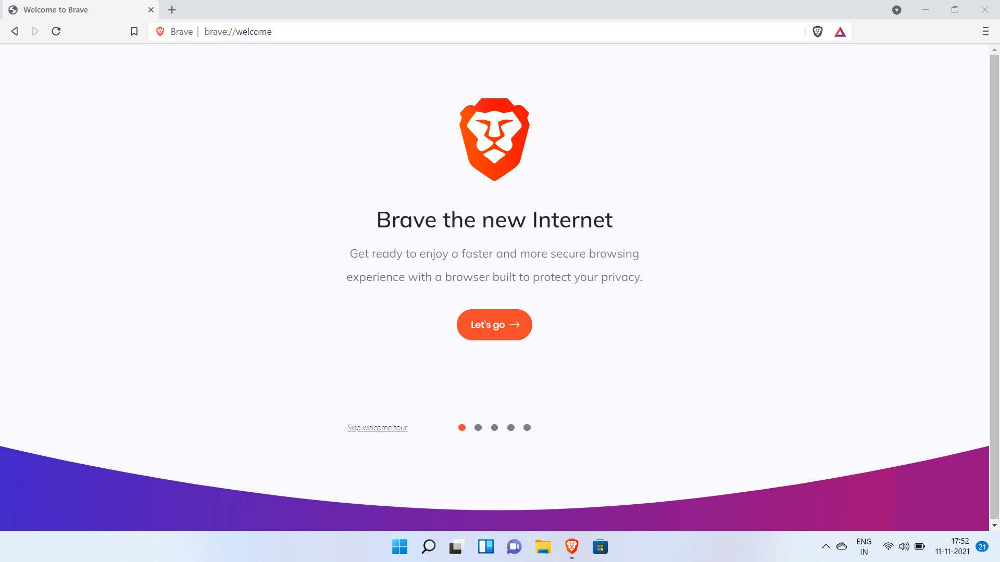

自动化脚本跑完并不等于任务完成。页面可能加载了旧数据，点击可能落在错误的元素上，结果也可能没有被保存。把关键断言、截图和失败重试写进流程，才能把“看起来成功”变成可以复核的结果。边界在于，端到端测试不应替代单元测试，而应覆盖真正的用户路径。

### 3. 开源维护需要可见的负担分配

一个项目是否健康，不只看 stars 或最近一次发布，还要看 issue 是否有人响应、依赖是否更新、贡献者是否集中在一个人身上。使用开源软件时，给关键依赖留出升级和替换预算，往往比临时寻找“绝对安全”的项目更可靠。

## 科技与 AI 动态

### 1. [GitHub Actions 强化可复用工作流](https://github.blog/changelog/)

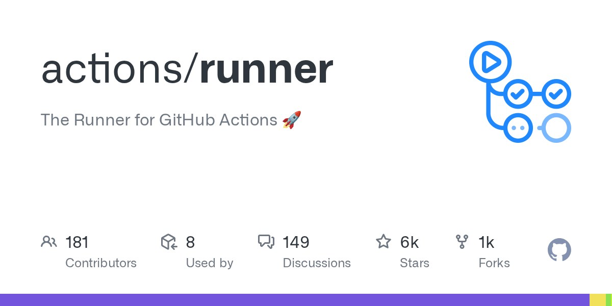

【事实】GitHub 持续扩展 Actions 的复用、权限和执行能力，让团队可以把重复的构建和检查抽成工作流。它降低了复制配置的成本，也把权限继承和凭证暴露带进了新的审查范围。

【推测】真正值得关注的不是步骤变少，而是默认权限是否足够窄。建议从一个低风险仓库开始，检查工作流 token、第三方 action 来源和日志中的秘密。

### 2. [Linux 内核持续推进可维护性](https://www.kernel.org/)

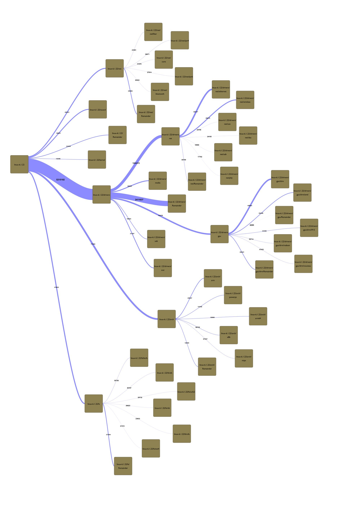

【事实】Linux 内核仍通过公开邮件列表、代码审查和稳定分支协作，维持一个规模极大的软件项目。公开审查让变更过程可追踪，也意味着贡献者需要理解项目的协作边界。

【推测】对普通团队而言，最值得借鉴的是“小变更、可回溯、有人负责”的节奏，而不是照搬内核的工具链。

### 3. [欧盟 AI Act 进入分阶段执行](https://digital-strategy.ec.europa.eu/en/policies/regulatory-framework-ai)

【事实】欧盟 AI Act 采取分阶段生效方式，对不同风险等级的系统提出不同要求。具体义务取决于应用场景、供应链位置和投放地区，不能只凭“用了模型”这一点判断。

【推测】产品团队应先建立模型、数据和用户场景清单，再判断哪些记录需要长期保存。早做映射，通常比临上线前补文档成本更低。

## 世界之最

### 1. 世界最大的水族馆之一：乔治亚水族馆

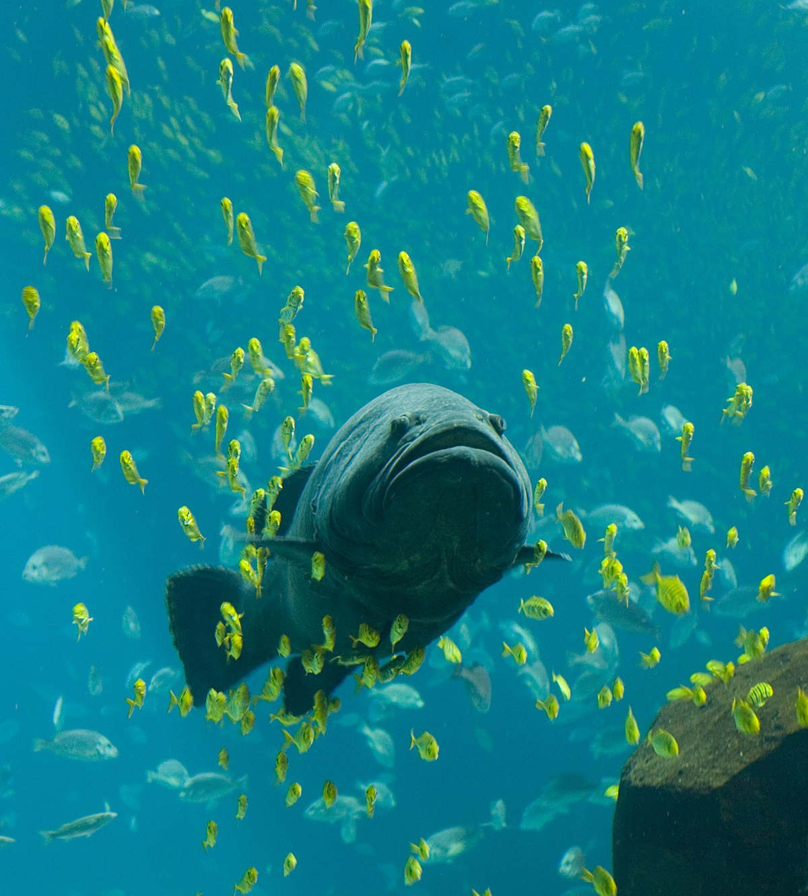

*乔治亚水族馆，亚特兰大；以大型鲸鲨展缸闻名。*

它把复杂生态系统压缩进可维护的空间：水质、温度、食物和生物状态都需要持续监测。对软件系统的启发很直接：规模变大后，稳定运行靠的不是一次性设计，而是密集的反馈回路。

### 2. 世界最大的风洞之一：NASA Ames 80x120 风洞

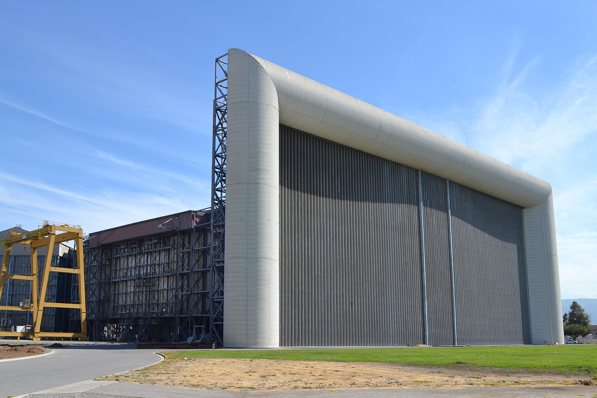

*NASA Ames 80x120 风洞，美国加州；用于大型飞行器和工程测试。*

风洞的价值在于把真实世界的复杂气流变成可控实验。agent 评测也需要类似思路：固定输入、控制变量、记录输出，才能区分能力提升和偶然表现。

### 3. 世界最大的室内滑雪场之一：迪拜滑雪场

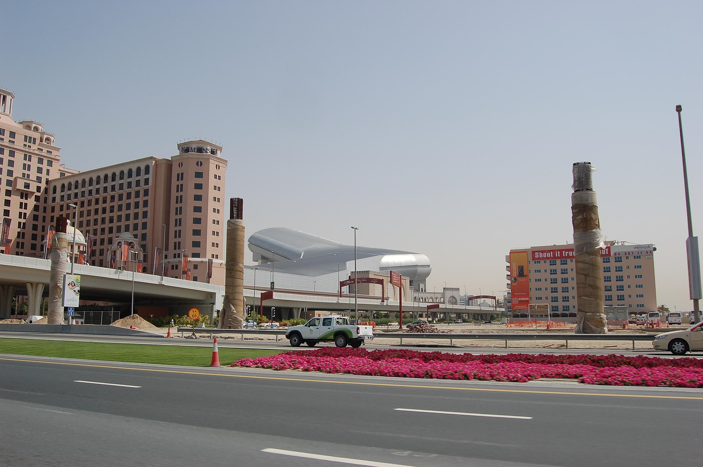

*Ski Dubai，阿联酋迪拜；在炎热城市中维持室内雪场。*

它是一个极端的环境控制工程：外界条件与内部体验完全不同。软件里的沙箱、模拟服务和测试数据也在做同一件事，让高风险行为先在可控环境里发生。

### 4. 世界最大的球形建筑：拉斯维加斯 Sphere

*Sphere，拉斯维加斯；巨型球形场馆的外部屏幕可呈现高密度影像。*

巨大表面积带来巨大表达能力，也带来内容、能耗和维护成本。工程系统的“更大”从来不是免费升级；当团队扩展 agent 权限时，同样要把运维和故障成本算进收益。

### 5. 世界最大的海水淡化厂之一：Ras Al Khair

*Ras Al Khair，沙特阿拉伯；大型海水淡化与发电综合设施。*

淡化厂把不可直接饮用的资源变成稳定供给，背后是连续的过滤、检测和能量管理。数据管道也需要这种纪律：输入不可信时先标记和隔离，而不是让错误悄悄流到最终答案。

## 工具深挖

### 1. [OpenTelemetry：把观测信号统一起来](https://opentelemetry.io/)
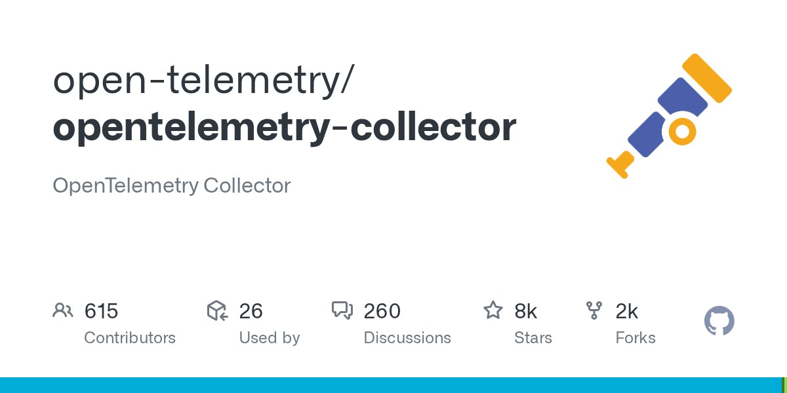
OpenTelemetry 统一 traces、metrics 和 logs 的采集语义，适合已经跨多个服务、开始难以定位问题的团队。它不是自动诊断器，落地前要先定义关键请求和服务边界，否则只会得到更多数据。

### 2. [Git：让每次改变都有出处](https://git-scm.com/)
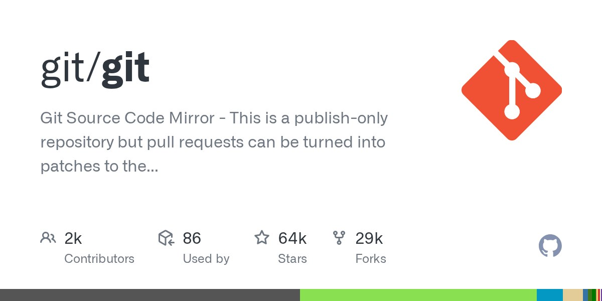
Git 的价值不只是保存代码，更是让变更可以比较、讨论和撤销。团队不必追求每次提交都完美，但应避免把多个无关动作压成一个无法解释的大提交。

### 3. [Playwright：验证真实浏览器路径](https://playwright.dev/)
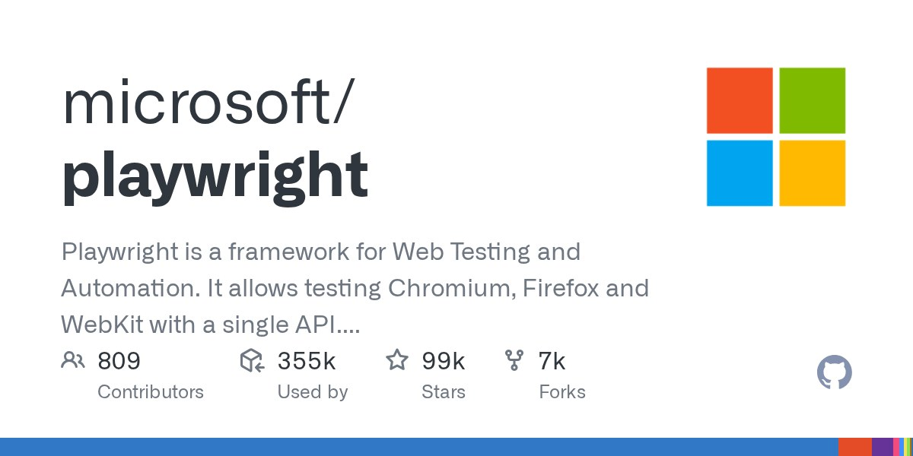
Playwright 适合覆盖登录、表单、支付等用户真正会走过的路径。它的成本是运行时间和测试维护，建议只把高价值流程放进端到端层，其他逻辑留在更快的测试里。

### 4. [OpenSSF Scorecard：检查开源依赖信号](https://github.com/ossf/scorecard)
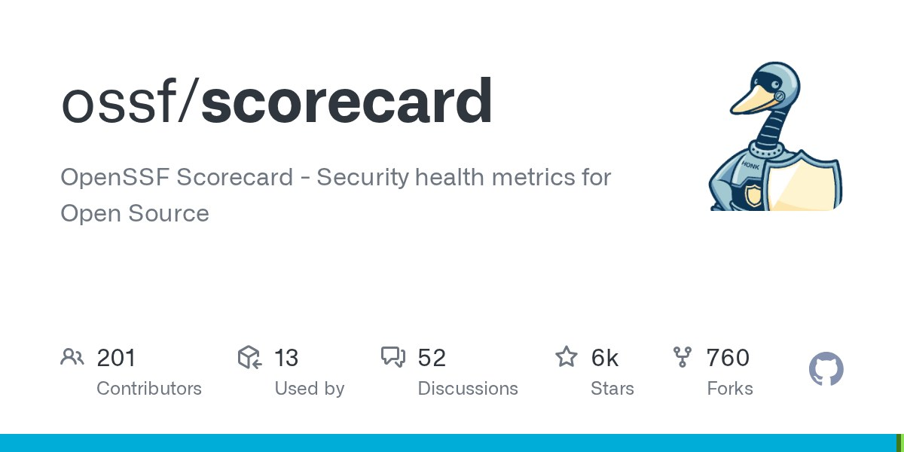
Scorecard 可以帮助团队快速查看分支保护、危险工作流和依赖维护等信号。分数只能作为起点，不能替代对项目用途、版本和维护者响应速度的判断。

## 本周冷知识 / 彩蛋

- 🥚 **冷知识**：可观测性里的 trace 原本就是“轨迹”的意思，重点不是记录更多，而是把一次请求经过的路径串起来。
- 🧠 **彩蛋**：Git 的对象模型用内容寻址保存数据，所以同一内容在不同引用关系中仍可被识别为同一个对象。

## 小七的碎碎念

我越来越相信，成熟系统的魅力不是“什么都不会坏”，而是坏了以后能很快告诉你坏在哪里。自动化如果只负责把按钮按下去，最后还是会把解释工作留给人类。

## 意外推荐（非科技）

**《降临》**（电影）

它把“理解一个系统”拍成了耐心的工作：先建立共同语言，再判断下一步。技术团队处理复杂需求时，也常常不是缺少聪明人，而是缺少共享的上下文。

## 互动钩子

> **本周问题：你所在的项目里，哪一个“看似自动完成”的步骤最需要补一条可验证证据？**

## 本周行动清单

- [ ] 为一个关键流程补充成功断言、失败日志和可撤销动作。
- [ ] 检查一个 CI 工作流的默认权限与第三方 action 来源。
- [ ] 给一个关键开源依赖建立版本、维护状态和替换成本记录。
- [ ] 选一条真实用户路径加入浏览器自动化测试。

### 📬 喜欢这期内容？

订阅「小七的周刊」，每周一收到最新一期。

  <a href="/feed.xml" class="cta-rss" target="_blank" rel="noopener noreferrer">RSS 订阅</a>
  <a href="https://github.com/leeseven1211/blog-weekly" class="cta-share" target="_blank" rel="noopener noreferrer">GitHub</a>

