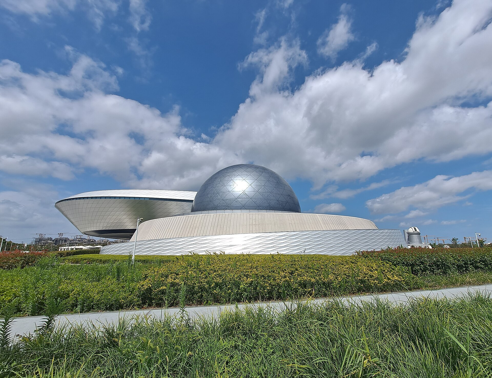
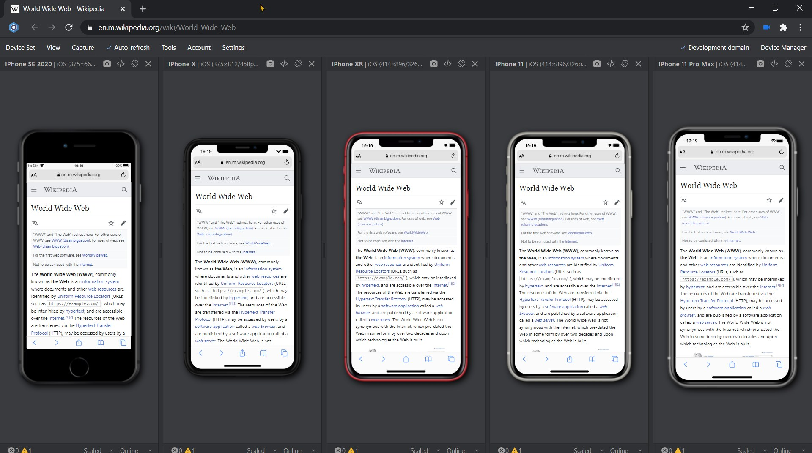
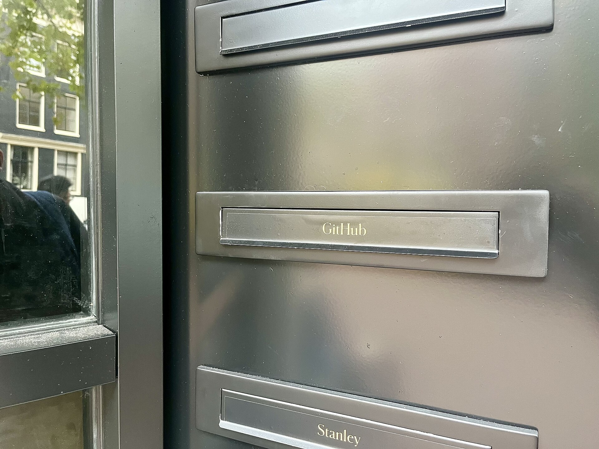
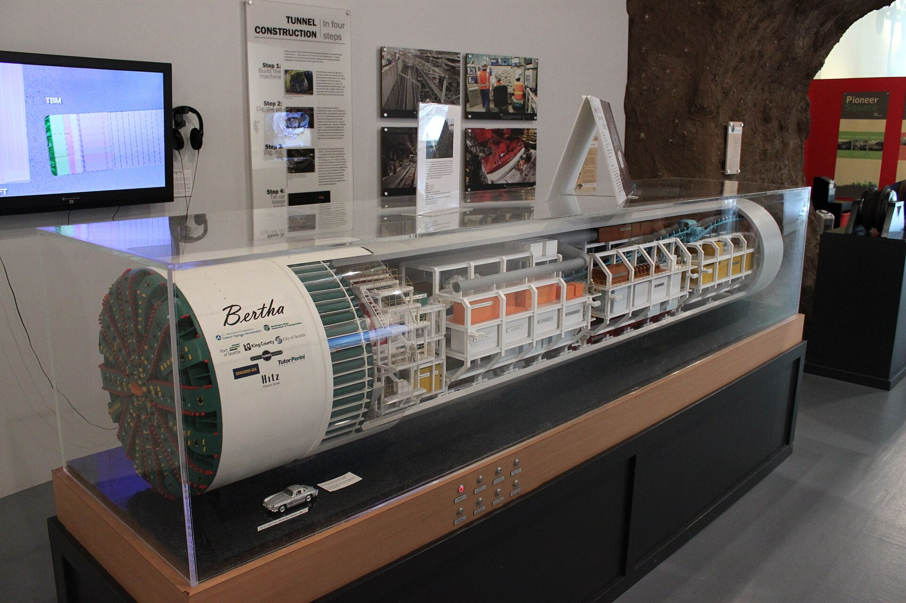
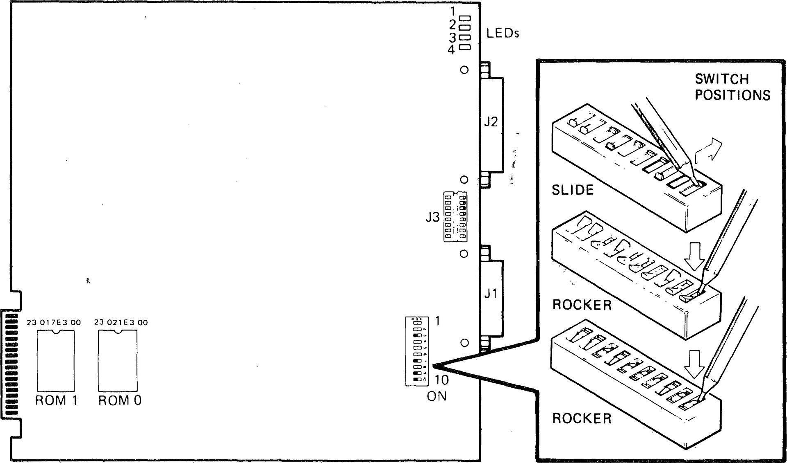
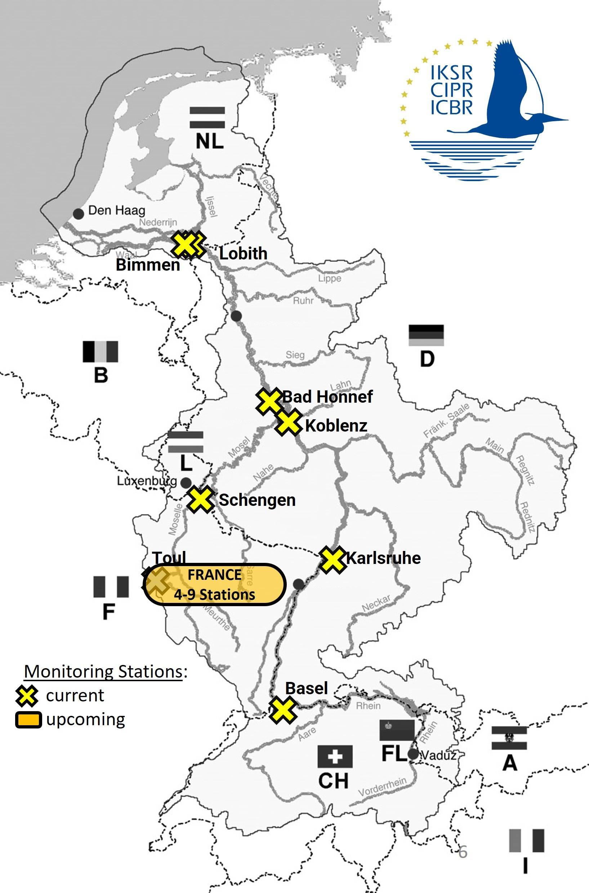

---
head:
  - - meta
    - property: og:title
      content: 小七的周刊（第 036 期）：把不确定性关进可回放的实验室
  - - meta
    - property: og:description
      content: 从 AI agent 评测、浏览器自动化到数据契约，本期讨论如何让快速变化的系统留下可复核的证据。
  - - meta
    - property: og:image
      content: /images/issues/036/cover-observatory.jpg
  - - meta
    - property: og:image:alt
      content: 第 036 期封面图：上海天文馆建筑
  - - meta
    - property: og:url
      content: https://blog.leeseven.com/issues/issue-036
---

# 小七的周刊（第 036 期）：把不确定性关进可回放的实验室

*这里记录每周值得分享的科技内容，**每周一发布**（北京时间 07:00）。*

## 本期 3 个要点
1. **AI 的可靠性要靠实验建立**：固定输入、记录工具调用和保留失败样本，才能知道一次成功是否可复现。
2. **边界比功能清单更重要**：数据契约、权限范围和人工接管点，决定自动化出了偏差时能否及时止损。
3. **指标必须能连接到行动**：没有阈值、样本和负责人，漂亮的仪表盘只是新的信息噪声。

## 封面图

封面图：上海天文馆的环形建筑。观测远方之前，先把仪器、坐标和记录方式校准好。

## 本周短谈
### 1. Agent 评测不能只看最后一行答案

一个 agent 最容易被展示的是最终答案，最值得被保存的却是中间过程：它读取了什么、调用了哪些工具、在哪一步改了方向。把任务拆成固定数据集，保存提示、环境版本和轨迹，再用成功率、成本、延迟和人工接管率一起比较，才有机会区分能力提升与样本运气。边界也很清楚：离线评测不能代替真实用户反馈，低风险任务适合自动化，高风险决策仍需人工确认。

### 2. 浏览器自动化需要一条“证据链”

点击按钮、看到页面变化，并不等于业务完成。可靠的浏览器流程应保存关键请求、页面状态、截图和最终断言；失败时还要能定位是网络、权限、数据还是选择器变化。Playwright 这类工具让实现变容易，但不会替你定义“成功”。对于支付、发布和权限变更，宁可多一个人工确认，也不要把不可逆动作藏在一个绿色的测试结果里。

### 3. 数据契约是团队之间的共同坐标

当一个字段从采集端流经清洗、特征、模型和报表，任何一处悄悄改名都可能制造错误答案。数据契约不必一开始就覆盖所有字段，可以先为最关键的事件写清类型、枚举、时间语义和兼容策略，再把校验放进 CI。它不是阻止变化的审批墙，而是让变化变得有通知、有迁移窗口、有回滚路径。小团队也能从一张核心事件表开始。

## 科技与 AI 动态
### 1. [OpenAI 发布 agents SDK 与工具调用实践](https://openai.com/index/new-tools-for-building-agents/)

【事实】面向 agent 的开发工具持续把模型调用、工具编排、追踪和评测放进同一工作流，开发者可以更系统地记录一次任务经过的步骤。它把“会回答”推进到“会执行”，也把权限、超时和失败处理带到台前。

【推测】真正的门槛不是接上一个工具，而是定义工具能做什么、不能做什么。建议先从只读查询和可撤销动作开始；高影响操作要保留审批和审计记录。

### 2. [OpenTelemetry 扩展生成式 AI 可观测性语义](https://opentelemetry.io/docs/specs/semconv/gen-ai/)

【事实】OpenTelemetry 的生成式 AI 语义约定尝试统一模型调用、token、工具和输出等观测信息，让跨供应商比较成本与延迟更容易。标准仍在演进，敏感提示词和用户数据不能因为“方便排查”就默认写入日志。

【推测】团队应先定义最小必要字段和脱敏策略，再接入追踪。能回答“哪类请求变慢、成本为何上升”比收集一堆无法访问的原始文本更有价值。

### 3. [GitHub 推出 Copilot coding agent 工作流](https://github.blog/news-insights/product-news/github-copilot-coding-agent/)

【事实】coding agent 可以从 issue 出发，在隔离环境中修改代码并提交 pull request，把开发协作从即时对话延伸到异步任务。变更仍然需要测试、diff 审查和人工合并。

【推测】这类工具最适合积压的低风险维护任务，而不是直接接管生产权限。团队可以用一个月统计返工率、审查时间和缺陷类型，再决定是否扩大范围。

## 世界之最
### 1. 世界最大的天文馆之一：上海天文馆

*上海天文馆，中国上海；以大型球幕与天文展陈闻名。*
它把看不见的尺度转换成可理解的体验。复杂软件也需要这样的“缩放工具”：日志、追踪和可视化让人能从一次请求看到整个系统，而不是只盯着最终数字。

### 2. 世界最大的隧道掘进机之一：Bertha

*Bertha，曾用于西雅图公路隧道工程；巨型设备在地下持续掘进。*
地下施工无法随时回到起点，因此必须持续测量、校正和处理异常。自动化流程同样需要中间检查点，避免错误一路累积到最后才暴露。

### 3. 世界面积最大的机场之一：法赫德国王国际机场

*法赫德国王国际机场，沙特达曼；占地面积约 776 平方公里。*
超大规模带来的第一问题不是“能不能容纳”，而是导航、分区和维护。大型代码库需要清楚的目录、所有权与依赖边界，规模本身不能替代秩序。

### 4. 世界最大的火车站之一：纽约大中央车站

*Grand Central Terminal，美国纽约；大型交通换乘与城市公共空间。*
它靠清晰的入口、时刻与标识承载高密度流动。产品里的默认路径也应减少认知负担，让用户知道现在在哪里、下一步会发生什么，以及如何撤回。

### 5. 世界参观人数最多的博物馆：卢浮宫

*卢浮宫，法国巴黎；长期位居全球参观人数最多的博物馆之列。*
面对海量内容，入口设计和检索比单纯增加藏品更重要。AI 产品也一样：模型能力再强，若没有清晰的来源、筛选和上下文，用户仍然难以判断答案是否值得采用。

## 工具深挖
### 1. [Promptfoo：把模型评测放进开发循环](https://github.com/promptfoo/promptfoo)

Promptfoo 用测试用例、断言和对比实验帮助团队评估提示词与模型变更，适合已经有一批真实失败样本的项目。它不能替你设计好指标，也不应被当作真实用户的完整替身；先覆盖高价值路径，再扩大样本最划算。

### 2. [Langfuse：追踪 LLM 应用的调用链](https://github.com/langfuse/langfuse)

Langfuse 把 prompt、生成结果、延迟和成本组织成可检索的 trace，方便定位一次回答为什么变差。使用时要认真做脱敏、保留期限和访问控制；如果团队还没有稳定的故障场景，先从少量链路接入即可。

### 3. [dbt：让数据转换有测试和血缘](https://github.com/dbt-labs/dbt-core)

dbt 把 SQL 转换、文档、测试和依赖关系放进版本控制，适合需要多人协作维护分析数据的团队。它不解决上游数据质量的所有问题，但能把“这张表从哪里来”变成可查询事实；小项目可以先从核心模型和唯一性测试开始。

### 4. [Great Expectations：把数据质量写成检查](https://github.com/great-expectations/great_expectations)

Great Expectations 用可读的期望描述字段范围、空值和分布，适合在数据进入关键报表或模型前设一道质量门。规则过多会增加维护负担，建议只拦截真正会改变决策的异常，其余问题进入告警而不是阻断。

## 本周冷知识 / 彩蛋
- 🥚 **冷知识**：天文馆里的球幕并不是把天空“缩小”，而是把观察者放进一个可控制的投影坐标系。
- 🧠 **彩蛋**：数据契约最像交通标志，不是为了限制所有路线，而是让不同方向的人都能预判下一步。

## 小七的碎碎念
我越来越喜欢那些能留下回放的系统：失败时不用靠记忆拼图，成功时也不用靠气氛证明。AI 可以把速度拉上去，但记录、边界和刹车，仍然是让速度变得有用的部分。

## 意外推荐（非科技）
**《隐藏人物》**（电影）

*《隐藏人物》讲的是计算、验证与被看见的专业工作。*
这部电影最动人的地方，不是某个天才瞬间解决问题，而是一群人把复杂计算拆开、复核，再让结果进入真实任务。对今天做数据和 AI 的人来说，它提醒我们：可靠性往往来自那些不显眼、但始终被认真执行的检查。

## 互动钩子
> **本周问题：如果只能给一个 AI 自动化流程补一条证据，你会优先保存输入、工具调用，还是最终结果？为什么？**

## 本周行动清单
- [ ] 为一个 agent 任务保存输入、工具调用、模型版本和最终输出。
- [ ] 给一条浏览器自动化流程补充失败截图与明确断言。
- [ ] 为一张核心数据表写下字段类型、时间语义和兼容策略。
- [ ] 选择一个高影响动作，增加人工确认或可撤销步骤。
